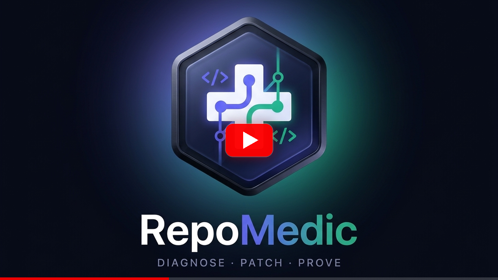
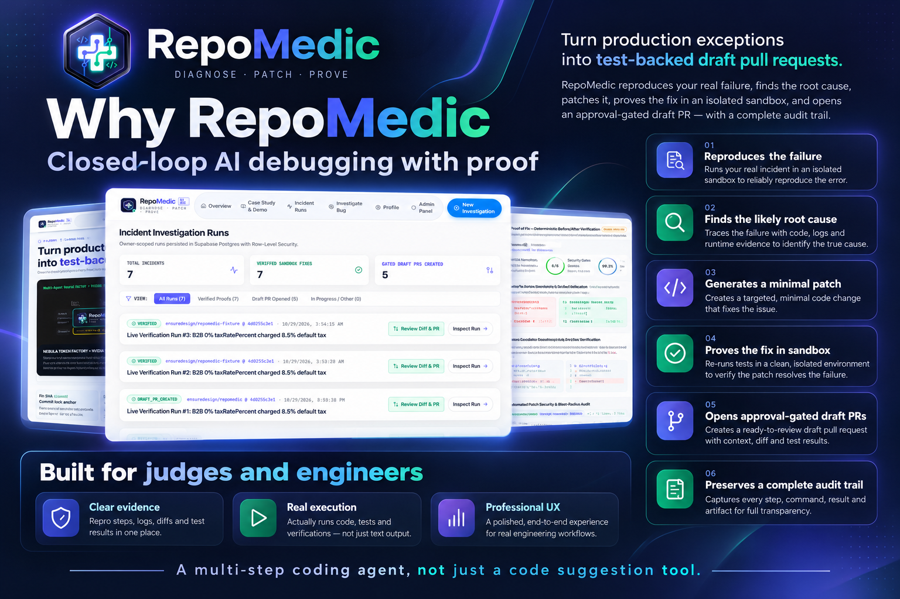
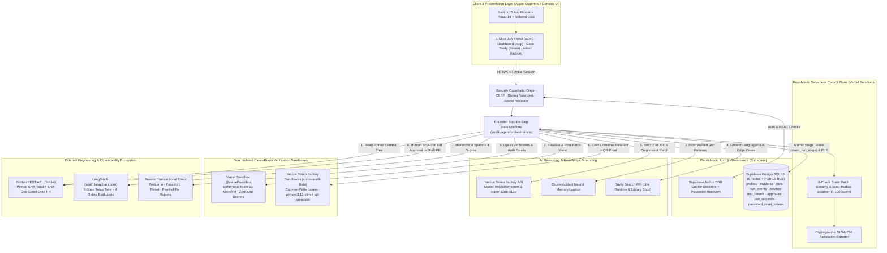
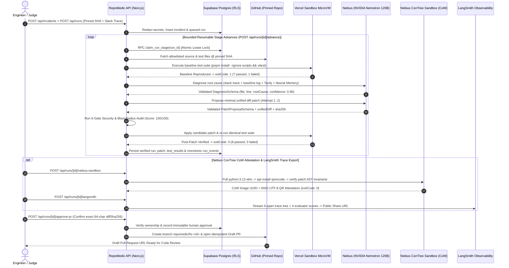
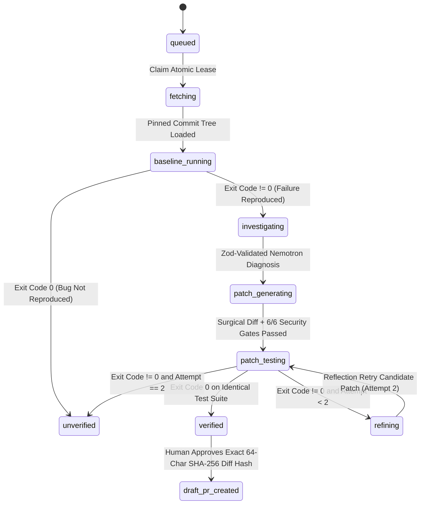
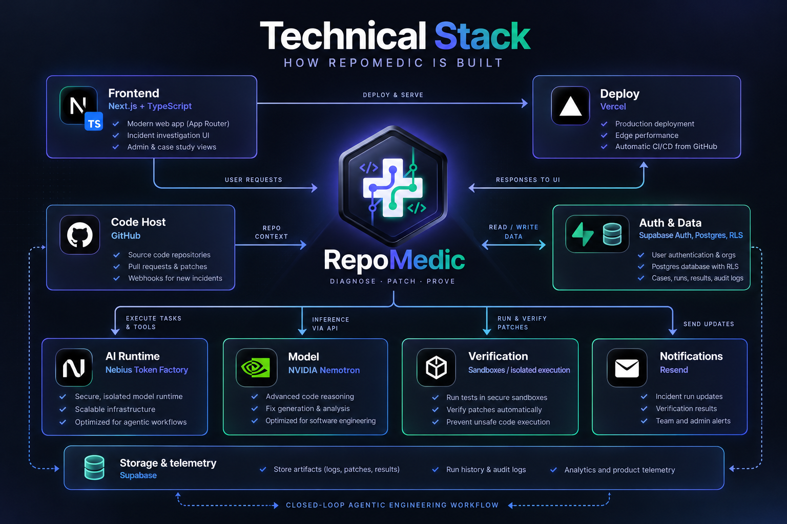
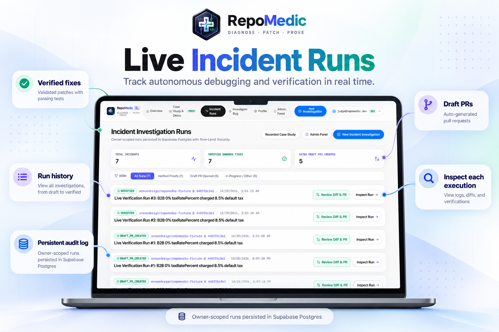

<div align="center">


# RepoMedic — Diagnose. Patch. Prove.

### **Autonomous Closed-Loop Production Incident Investigator & Self-Verifying Coding Agent**

Built for the **Nebius × NVIDIA Global AI Hackathon** (*Coding and Agentic Engineering* Track)

[](https://repomedic-eta.vercel.app)
[-FF0000?style=for-the-badge&logo=youtube&logoColor=white)](https://youtu.be/4Yephus8x1g)
[](https://repomedic-eta.vercel.app/auth)

[](https://tokenfactory.nebius.com)
[](https://repomedic-eta.vercel.app/api/ai/health)
[-0EA5E9?style=flat-square)](https://docs.tokenfactory.nebius.com/sandboxes/overview)
[](https://vercel.com/docs/vercel-sandbox)
[](https://smith.langchain.com/public/a843df4b-dbaf-4a10-8753-33b85ea59bcf/r)
[](https://supabase.com)
[](./LICENSE)

<p align="center">
  <a href="#official-app-demo-video">Demo Video</a> •
  <a href="#1-why-repomedic">Why RepoMedic</a> •
  <a href="#2-what-repomedic-does">What It Does</a> •
  <a href="#3-how-repomedic-works--system-flow-diagrams">How It Works & Flow Diagrams</a> •
  <a href="#4-full-technical-stack">Technical Stack</a> •
  <a href="#5-live-incident-runs">Live Runs</a> •
  <a href="#6-proof-of-fix--security-verification">Proof of Fix</a> •
  <a href="#7-admin-control-plane--governance">Admin Control Plane</a> •
  <a href="#8-instant-1-click-judge-access">1-Click Jury Login</a> •
  <a href="#9-full-technical-documentation">Technical Docs</a>
</p>

</div>

---

> **Executive Summary:** RepoMedic turns production exceptions, stack traces, and failing CI tests into **test-backed, security-audited, human-approved GitHub Draft Pull Requests**. Unlike standard LLM chat wrappers that emit speculative code snippets, RepoMedic pins the exact Git commit SHA, reproduces the real failure inside isolated sandboxes (`exit 1`), diagnoses the root cause using **NVIDIA Nemotron (`nvidia/nemotron-3-super-120b-a12b`)** on **Nebius Token Factory**, generates a minimal surgical patch, proves the fix across **Vercel Sandbox** and **Nebius Token Factory Sandboxes (`contree-sdk`)** (`exit 0`), audits 6 static security guardrails, traces every span in **LangSmith**, and gates any GitHub write behind an explicit **64-character SHA-256 diff hash human approval**.

---

## Official App Demo Video

<div align="center">
  <a href="https://youtu.be/4Yephus8x1g">
    
  </a>
  <p>
    <strong>▶ <a href="https://youtu.be/4Yephus8x1g">Watch Official 1080p Demo Video on YouTube (https://youtu.be/4Yephus8x1g)</a></strong>
    &nbsp;•&nbsp;
    <a href="https://repomedic-eta.vercel.app/demo-assets/repomedic-hackathon-demo-2min.mp4">Direct 1080p MP4 Mirror</a>
  </p>
</div>

---

## Quick Production Links & Live Artifacts

| Resource | Live URL / Reference |
| :--- | :--- |
| **Live Production Web App (Vercel)** | [https://repomedic-eta.vercel.app](https://repomedic-eta.vercel.app) |
| **Official YouTube App Demo Video (`2:31` 1080p HD)** | [https://youtu.be/4Yephus8x1g](https://youtu.be/4Yephus8x1g) |
| **Direct 1080p MP4 Demo Video Mirror** | [https://repomedic-eta.vercel.app/demo-assets/repomedic-hackathon-demo-2min.mp4](https://repomedic-eta.vercel.app/demo-assets/repomedic-hackathon-demo-2min.mp4) |
| **1-Click Judge & Admin Login Portal (`/auth`)** | [https://repomedic-eta.vercel.app/auth](https://repomedic-eta.vercel.app/auth) |
| **Zero-Auth Recorded Case Study (`/demo`)** | [https://repomedic-eta.vercel.app/demo](https://repomedic-eta.vercel.app/demo) |
| **Platform Admin Control Plane (`/admin`)** | [https://repomedic-eta.vercel.app/admin](https://repomedic-eta.vercel.app/admin) |
| **Live Infrastructure & Nemotron Health Probes** | [`/api/health`](https://repomedic-eta.vercel.app/api/health) · [`/api/ai/health`](https://repomedic-eta.vercel.app/api/ai/health) |
| **Public Allowlisted Target Fixture Repository** | [https://github.com/ensuredesign/repomedic-fixture](https://github.com/ensuredesign/repomedic-fixture) (`@ 440255c3e1ef...`) |
| **Live Approval-Gated GitHub Draft PR Sample** | [ensuredesign/repomedic-fixture#4](https://github.com/ensuredesign/repomedic-fixture/pull/4) |
| **Live Public LangSmith 6-Span Agent Trace** | [smith.langchain.com/public/a843df4b-dbaf-4a10-8753-33b85ea59bcf/r](https://smith.langchain.com/public/a843df4b-dbaf-4a10-8753-33b85ea59bcf/r) |

---

## 1. Why RepoMedic?

<p align="center">
  
</p>

### The 3:00 AM Production Triage Bottleneck

When a critical regression hits production, on-call engineers spend **45 to 90 minutes** manually context-switching across alert payloads, Git commit histories, local test runners, and pull request templates. Existing AI coding assistants fall short in production incident response because they **guess without executing**:

| Capability | Standard AI Code Chat / Autocomplete | **RepoMedic Closed-Loop Agent** |
| :--- | :--- | :--- |
| **Failure Reproduction** | Assumes user prompt describes the bug | **Clones pinned commit SHA & reproduces `exitCode !== 0` in sandbox** |
| **Root-Cause Grounding** | Hallucinates unpinned file lines | **Line-linked `DiagnosisSchema` backed by AST/file evidence & Tavily docs** |
| **Patch Scope Control** | Rewrites entire files unnecessarily | **Minimal surgical unified diff (`100/100` Blast-Radius Score)** |
| **Verification Proof** | None — human must pull, apply & test | **Dual isolated sandboxes: Vercel MicroVM + Nebius ConTree CoW (`exit 0`)** |
| **Security & Tamper Audit** | None — may edit tests to force green | **6-gate static security scanner (`NO_TEST_TAMPERING`, `NO_SHELL_INJECTION`)** |
| **GitHub Write Governance** | Auto-commits or leaves copy-paste blobs | **Cryptographic 64-char SHA-256 human approval gate → Draft PR only** |
| **Observability & Provenance** | Opaque prompt/response | **LangSmith 6-span trace + 4 evaluators + SLSA-256 Attestation JSON** |

---

## 2. What RepoMedic Does

<p align="center">
  
</p>

RepoMedic operates as a **six-pillar autonomous software reliability workflow**:

1. **Reproduce the Bug Deterministically:** Points to an allowlisted repository and pinned Git commit SHA, provisions an ephemeral clean-room sandbox with zero application secrets, and executes the test suite to confirm the exact baseline failure (`exitCode: 1`).
2. **Analyze Root Cause with NVIDIA Nemotron:** Invokes **`nvidia/nemotron-3-super-120b-a12b`** on **Nebius Token Factory**, enriched with cross-incident **Neural Memory** (`src/lib/agent/memory.ts`) and live **Tavily** documentation grounding (`src/lib/ai/tavily.ts`), producing a strict Zod-validated root-cause hypothesis and confidence score.
3. **Generate a Surgical Patch:** Synthesizes a minimal unified diff touching only affected implementation lines—never tampering with unit tests, lockfiles, or CI workflows—with bounded reflection retries (`Attempt 1..2`) if candidate verification fails.
4. **Verify in Isolated Sandboxes:** Applies the patch cleanly in memory and executes the full test suite inside **Vercel Sandbox** (`@vercel/sandbox`) and **Nebius Token Factory Sandboxes** (`contree-sdk` Copy-on-Write containers) to prove a deterministic `FAIL → PASS` transition.
5. **Create Approval-Gated Draft PRs:** Enforces human-in-the-loop governance—requiring an authenticated operator to approve the exact **64-character SHA-256 diff digest** before opening an idempotent GitHub **Draft** Pull Request (`repomedic/fix-<run-id>`).
6. **Preserve an Immutable Audit Trail:** Persists every stage event, redacted terminal log, token count, latency metric, LangSmith trace URL, and downloadable **SLSA-256 Attestation JSON** in **Supabase PostgreSQL** under `FORCE ROW LEVEL SECURITY`.

---

## 3. How RepoMedic Works & System Flow Diagrams

<p align="center">
  
</p>

### 3.1 High-Level End-to-End System Architecture Flow



### 3.2 Closed-Loop Execution & Verification Sequence Diagram



### 3.3 Bounded Resumable Investigation State Machine

To avoid serverless timeout fragility or orphaned background promises, RepoMedic advances runs through an **atomic, database-leased state machine** (`public.claim_run_stage`):



---

## 4. Full Technical Stack

<p align="center">
  
</p>

| Architectural Layer | Technology | Role in RepoMedic |
| :--- | :--- | :--- |
| **Frontend & UX** | **Next.js 15 (App Router), React 19, TypeScript 5.8, Tailwind CSS** | Responsive Apple Cupertino / Genesis interface, WCAG AA contrast, interactive SVG telemetry rings, diff inspector, and real-time stage timeline |
| **AI Inference Runtime** | **Nebius Token Factory** (`api.tokenfactory.us-central1.nebius.com/v1`) | High-throughput OpenAI-compatible inference endpoint with server-only credential isolation and strict latency/token accounting |
| **Foundation Model** | **NVIDIA Nemotron (`nvidia/nemotron-3-super-120b-a12b`)** | Multi-step root-cause reasoning, surgical unified diff synthesis, bounded reflection retries, and interactive incident copilot Q&A |
| **CoW Container Sandbox** | **Nebius Token Factory Sandboxes (Beta) (`contree-sdk`)** | Spawns Copy-on-Write (`CoW`) Linux VMs (`python:3.12-slim`), installs system tools (`apt-get install qrencode`), verifies patch invariants, and generates ANSI QR provenance |
| **Node Test MicroVM** | **Vercel Sandbox (`@vercel/sandbox`)** | Ephemeral Node 22 microVMs running `pnpm install --ignore-scripts` and `npx vitest run` for deterministic before/after exit-code proof |
| **Agent Observability** | **LangSmith (`smith.langchain.com`)** | Automatic LLM call tracing + 6-span hierarchical run trees (`chain → retriever → tool → llm → tool → chain`), 4 online evaluators, and public trace sharing |
| **Live Web Grounding** | **Tavily Search API** | Retrieves authoritative TypeScript/Node.js specification & library edge-case documentation during root-cause diagnosis |
| **Auth, DB & Security** | **Supabase Auth + PostgreSQL 15 (`FORCE RLS`)** | 9 normalized tables, Row-Level Security ownership policies, RBAC `admin` governance triggers, atomic stage locks, and custom SHA-256 password reset tokens |
| **Source Control** | **GitHub REST API (`@octokit/rest`)** | Reads allowlisted repositories at pinned commit SHAs and opens idempotent **Draft** Pull Requests only after cryptographic diff approval |
| **Transactional Email** | **Resend (`RepoMedic <info@ensure.in>`)** | Sends branded registration welcome emails, secure password reset links, and opt-in Proof-of-Fix / Draft PR executive summaries |
| **Demo Film Engine** | **Remotion 4.0 + Edge Neural TTS + FFmpeg** | Programmatic 60fps/30fps pixel-locked 1080p studio demo video (`remotion-demo/`) with spring-physics callouts and `-16 LUFS` mastered voiceover |

---

## 5. Live Incident Runs

<p align="center">
  
</p>

Every authenticated developer gets a dedicated, RLS-isolated **Incident Investigation Command Center (`/app`)**:

- **Owner-Scoped Persistence:** Every incident, run stage, candidate patch, and sandbox log is isolated per account in Supabase PostgreSQL (`auth.uid() = owner_id`).
- **Real-Time Stage Progression:** Watch live transitions across `queued` → `fetching` → `baseline_running` → `investigating` → `patch_generating` → `patch_testing` → `verified` → `draft_pr_created` with monotonic sequence numbers (`run_events.seq`).
- **Automatic Stale-Lease Recovery:** If a serverless invocation is interrupted mid-flight, `claim_run_stage` automatically reclaims expired leases (`>120s`) without duplicating events or corrupting state.

### Live End-to-End Closed-Loop Verification Benchmark (3 Consecutive Runs)

Executed via `pnpm test:closed-loop` (`tests/m2-m4-live-closed-loop.test.ts`) against [`ensuredesign/repomedic-fixture@440255c3e1efe73a24d2cd92b90055c54c3e3549`](https://github.com/ensuredesign/repomedic-fixture/commit/440255c3e1efe73a24d2cd92b90055c54c3e3549):

| Run # | Run ID | Model ID | Baseline Sandbox | Patched Sandbox | Security Gates | Verified Diff SHA-256 | Outcome |
| :--- | :--- | :--- | :--- | :--- | :--- | :--- | :--- |
| **#1** | `016537a7-4a37-4b36-ab34-7ef6ea3898a3` | `nvidia/nemotron-3-super-120b-a12b` | `exit 1` (`7 pass, 1 fail`) | `exit 0` (`8 pass, 0 fail`) | `6/6 (100/100)` | `d2986c85dfb2...` | **Verified + [Draft PR #4](https://github.com/ensuredesign/repomedic-fixture/pull/4)** |
| **#2** | `5ca9e752-3292-488f-a672-d41057a8fdd3` | `nvidia/nemotron-3-super-120b-a12b` | `exit 1` (`7 pass, 1 fail`) | `exit 0` (`8 pass, 0 fail`) | `6/6 (100/100)` | `d2986c85dfb2...` | **Verified** |
| **#3** | `f088542e-5132-42c3-8636-68eb02192ff7` | `nvidia/nemotron-3-super-120b-a12b` | `exit 1` (`7 pass, 1 fail`) | `exit 0` (`8 pass, 0 fail`) | `6/6 (100/100)` | `d2986c85dfb2...` | **Verified** |

---

## 6. Proof of Fix & Security Verification

<p align="center">
  
</p>

RepoMedic treats **model output, repository files, and stack traces as untrusted inputs**. Before a fix is presented as `VERIFIED`, it must pass **multi-layered deterministic verification**:

1. **Side-by-Side Before/After Exit-Code Proof:**
   - **Baseline Check (`Unmodified SHA`):** Runs `npx vitest run` on pinned commit `440255c3e1ef...` → **`Exit Code 1`** (`AssertionError: expected 8.5 to be +0` on B2B tax-exempt `0%` order).
   - **Post-Patch Check (`Isolated Sandbox`):** Applies the 1-line nullish-coalescing fix (`taxRatePercent ?? defaultRatePercent` in `src/pricing.ts`) → **`Exit Code 0`** (`8 passed, 0 failed`).
2. **6-Gate Automated Patch Security & Blast-Radius Scanner (`src/lib/security/patch-scanner.ts`):**
   - `NO_DYNAMIC_CODE_EXEC`: Blocks `eval()`, `new Function()`, and `vm.runInNewContext()`.
   - `NO_SHELL_INJECTION`: Blocks `child_process`, `execSync()`, `spawn()`, and shell primitives.
   - `NO_SECRET_LITERALS`: Scans added diff lines for API keys, bearer tokens, or private PEM blocks.
   - `NO_TEST_TAMPERING`: Guarantees test files (`tests/**`, `*.test.ts`) are never weakened, deleted, or `.skip`ped.
   - `NO_DEPENDENCY_DRIFT`: Blocks unauthorized edits to `package.json`, lockfiles, `.env*`, or `.github/workflows/**`.
   - `CRYPTOGRAPHIC_DIFF_INTEGRITY`: Computes and verifies the canonical 64-character SHA-256 diff digest.
3. **Nebius Token Factory Sandboxes (`contree-sdk`) Live CoW Attestation:**
   - Spawns an isolated Copy-on-Write session on `https://api.tokenfactory.nebius.com` (Project `aiproject-e00am2xdmcyzgvf9s5`), installs `qrencode` via `apt-get`, runs Python AST & arithmetic boundary invariants (`0% == 0`, `null -> 8.5%`, `undefined -> 8.5%`), snapshots the final CoW image UUID (e.g., `51cc2a41-f6ac-4de1-a792-d93c1b888c8f`), and renders an ANSI UTF-8 QR verification badge directly in the UI.
4. **LangSmith 6-Span Trace & Online Evaluators (`smith.langchain.com`):**
   - Publishes a complete 6-span trace tree (`RepoMedic Closed-Loop Investigation` → `Retrieve Pinned Repository & Neural Memory` → `Vercel Sandbox Baseline Reproduction` → `NVIDIA Nemotron Root-Cause & Patch Synthesis` → `Isolated Post-Patch Verification & 6-Check Security Audit` → `SLSA-256 Attestation & Draft PR Gate`) scored across 4 automated evaluators (`sandbox_verification_pass`, `security_blast_radius_score`, `nemotron_diagnosis_confidence`, `mttr_compression_ratio`).
5. **Interactive Nemotron Incident Copilot & SLSA-256 Attestation Export:**
   - Engineers can ask live technical questions grounded in the exact run's diff and logs (`/api/runs/[id]/copilot`) and download a signed-style **SLSA-256 Attestation JSON** (`/api/runs/[id]/attestation`).

---

## 7. Admin Control Plane & Governance

<p align="center">
  
</p>

Platform administrators gain enterprise-grade operational oversight at **`/admin`**:

- **Global Platform Telemetry:** Real-time KPIs tracking registered developers, total runs, verified sandbox proofs, human-approved Draft PRs, and cumulative Nebius Token Factory token consumption & estimated inference cost.
- **Live Infrastructure & Guardrail Matrix:** Displays active status of Nebius Nemotron (`nvidia/nemotron-3-super-120b-a12b`), repository allowlist (`ensuredesign/repomedic-fixture`), isolated filesystem enforcement, RLS policies, and secret redaction filters.
- **User Directory & PostgreSQL RBAC Governance:** Promote or demote users between `developer` and `admin` roles via the `SECURITY DEFINER` RPC `public.admin_set_user_role(uuid, text)`, backed by trigger `public.guard_profile_role_update()` which blocks privilege self-escalation at the database layer.
- **Global Runs Audit Log:** Cross-tenant read-only audit visibility into every autonomous run, verification exit code, and Draft PR link across the organization.

---

## 8. Instant 1-Click Judge Access

Visit **[https://repomedic-eta.vercel.app/auth](https://repomedic-eta.vercel.app/auth)** to evaluate every persona immediately—or register a brand-new account with live welcome email delivery and password-reset support:

| Persona | 1-Click Action on `/auth` | Account | What You Can Test Immediately |
| :--- | :--- | :--- | :--- |
| **Developer / Judge** | **1-Click User / Judge Login** | `judge@repomedic.dev` | Inspect 3 live verified Nemotron + Sandbox runs, trigger **Nebius ConTree CoW Verification**, export **Public LangSmith Traces**, chat with **Nemotron Copilot**, launch a new live investigation (`/app/incidents/new`), update profile/password (`/app/profile`), and approve a GitHub Draft PR |
| **Platform Admin** | **1-Click Admin Panel Login** | `admin@repomedic.dev` | Open the **Admin Control Plane (`/admin`)**, inspect global token & sandbox KPIs, manage User Directory & RBAC roles (`developer` ↔ `admin`), and audit global runs |
| **Anonymous Guest** | **Open Case Study (`/demo`)** | No login required | Explore the curated read-only recorded case study (`is_demo = true`), 6-check security audit, Nebius ConTree sandbox runner, LangSmith trace exporter, and SLSA-256 Attestation JSON |

---

## 9. Full Technical Documentation

Comprehensive architecture blueprints, ER diagrams, API specifications, and security audit reports are maintained in [`docs/`](./docs):

- [**Complete Technical Documentation & Engineering Manual (`docs/TECHNICAL_DOCUMENTATION.md`)**](./docs/TECHNICAL_DOCUMENTATION.md) — Deep-dive reference covering system workflows, dual-sandbox internals, LangSmith tracing, 9-table PostgreSQL ERD, all 20 REST API endpoints, and deployment runbooks.
- [**System Architecture, State Machine & Data Model (`docs/ARCHITECTURE.md`)**](./docs/ARCHITECTURE.md) — Focused architectural diagrams (`flowchart`, `stateDiagram-v2`, `erDiagram`), CoW sandbox pipeline, and security invariants.
- [**Cybersecurity & Quality Assurance Audit (`docs/SECURITY_AND_QUALITY_REPORT.md`)**](./docs/SECURITY_AND_QUALITY_REPORT.md) — Threat model, OWASP Top 10 controls, RLS verification tests, and secret redaction guarantees.
- [**Smooth 1080p Demo Video Script & Walkthrough Guide (`docs/DEMO_SCRIPT.md`)**](./docs/DEMO_SCRIPT.md) — Chapter-by-chapter narration & visual beat sheet for the `2:31` Remotion product film.
- [**Product Requirements Document (`PRD.md`)**](./PRD.md) & [**Environment Setup Guide (`SETUP.md`)**](./SETUP.md).

---

## 10. Project Structure & Local Quickstart

```text
RepoMedic/
├── public/
│   ├── appimages/                  # Official RepoMedic logo & 7 architecture/product visual banners
│   └── demo-assets/                # Mastered 2:31 smooth 1080p MP4 hackathon demo film
├── src/
│   ├── app/
│   │   ├── api/                    # 20 secure Next.js Route Handlers (runs, nebius-sandbox, langsmith, auth, admin)
│   │   ├── app/                    # Authenticated Developer Command Center, New Incident, Proof & PR Review, Profile
│   │   ├── admin/                  # RBAC-protected Platform Admin Control Plane
│   │   ├── auth/                   # 1-Click Judge Login, Registration, Forgot & Reset Password flows
│   │   └── demo/                   # Public Zero-Auth Interactive Case Study
│   ├── components/                 # Cupertino/Genesis UI components, Proof-of-Fix panel, Diff viewer, Bento hero
│   └── lib/
│       ├── agent/                  # Bounded state-machine orchestrator, patch applier & neural memory
│       ├── ai/                     # Nebius Token Factory (NVIDIA Nemotron 120B), Zod schemas & Tavily grounding
│       ├── sandbox/                # Dual sandboxes: Vercel Sandbox (@vercel/sandbox) & Nebius ConTree (contree-sdk)
│       ├── observability/          # LangSmith 6-span trace tree & 4 online evaluators
│       ├── security/               # 6-gate static patch scanner, secret redactor & CSRF/rate-limit guards
│       ├── github/                 # Pinned SHA reader & SHA-256 approval-gated Draft PR creator
│       ├── email/                  # Resend transactional emails (welcome, password reset, Proof-of-Fix report)
│       └── supabase/               # Browser/SSR/Admin Supabase clients & typed run bundle loader
├── supabase/migrations/            # 4 versioned PostgreSQL + FORCE RLS + RBAC SQL migrations
├── scripts/                        # Standalone Nebius ConTree sandbox runner & neural voiceover synthesis scripts
├── remotion-demo/                  # Remotion 4.0 composition for zero-shake 1080p smooth product film
├── fixtures/buggy-order-service/   # Deliberate B2B 0% tax regression fixture suite (Vitest)
└── tests/                          # Unit, live Supabase RLS/RBAC, closed-loop & Playwright E2E suites
```

### Run Locally in 3 Minutes

```bash
# 1. Install dependencies
pnpm install

# 2. Configure environment variables (see SETUP.md for server-only credentials)
cp .env.example .env.local

# 3. Optional: Install Nebius Token Factory Sandboxes Python SDK for local CoW sandbox runs
pip install contree-sdk

# 4. Start the development server
pnpm dev
```

### Verification & Quality Gates

```bash
pnpm lint               # Strict ESLint static analysis
pnpm typecheck          # TypeScript --noEmit full compiler check
pnpm test               # Vitest unit tests + live Supabase RLS/RBAC + live Nebius/Sandbox smoke tests
pnpm test:closed-loop   # 3 consecutive live end-to-end closed-loop runs + GitHub Draft PR verification
pnpm test:e2e           # Playwright desktop (1440x900) & mobile (390x844) verification suite
pnpm fixture:test       # Reproduces the deliberate baseline failure in fixtures/buggy-order-service
pnpm build              # Production Next.js build verification
```

---

## 11. License & Maintainer

Released under the **[MIT License](./LICENSE)**.  
Engineered and maintained by **Ritesh Kochar (`ensuredesign`)** — `ensure01@gmail.com` · [https://github.com/ensuredesign/repomedic](https://github.com/ensuredesign/repomedic)
