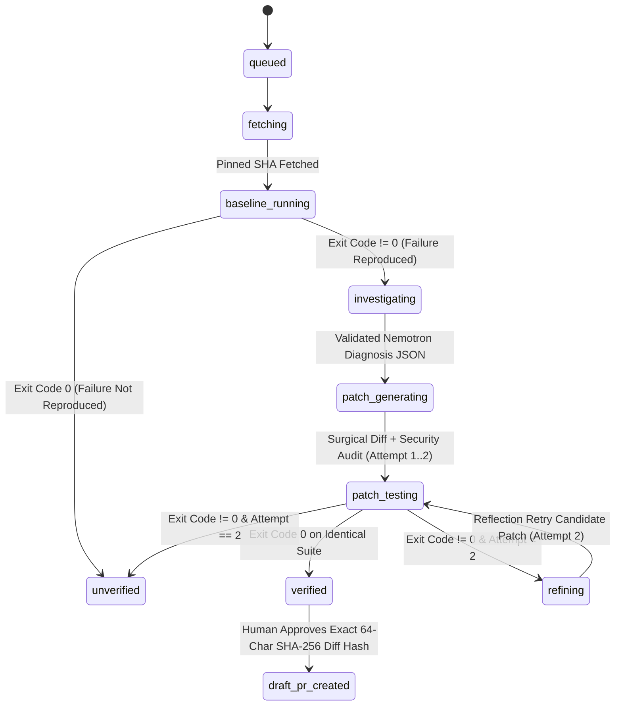

# RepoMedic Technical Architecture, Data Model & Security Specification

**Repository:** [https://github.com/ensuredesign/repomedic](https://github.com/ensuredesign/repomedic)  
**Production URL:** [https://repomedic-eta.vercel.app](https://repomedic-eta.vercel.app)  
**Author / Maintainer:** `ensuredesign` (`ensure01@gmail.com`)

---

## 1. High-Level System Architecture

```mermaid
flowchart TD
  Browser["Next.js 15 App Router UI (Genesis Design System · WCAG AA)"]
  Auth["Supabase Auth + SSR Session + 1-Click Hackathon Demo Logins"]
  API["Next.js Route Handlers\n/api/incidents · /api/runs · /api/profile · /api/admin/overview"]
  DB[("Supabase PostgreSQL 15 + FORCE RLS\nprofiles · incidents · runs · run_events\npatches · test_results · approvals · pull_requests")]
  Nebius["Nebius Token Factory API\nnvidia/nemotron-3-super-120b-a12b"]
  Sandbox["Vercel Sandbox SDK (@vercel/sandbox)\nIsolated Ephemeral Node 22 MicroVM"]
  Scanner["Deterministic Patch Security & Blast-Radius Scanner\n6 AST/Pattern Guardrails + Surgical Score (0-100)"]
  GitHub["GitHub REST API (Octokit)\nPinned SHA Read + SHA-256 Gated Draft PR"]
  Resend["Resend Email API\nOpt-In Proof-of-Fix & Draft PR Reports"]

  Browser -->|Cookie Session| Auth
  Browser -->|Advance Bounded Stages & Inspect Telemetry| API
  API -->|RLS-Scoped Queries, RBAC & Atomic Stage Locks| DB
  API -->|Server-Only NEBIUS_API_KEY + Strict Zod Schemas| Nebius
  API -->|Zero Secrets Passed · Isolated Baseline & Candidate Runs| Sandbox
  API -->|Static Diff Audit & SLSA Attestation Hash| Scanner
  API -->|Read Pinned Tree / Write Draft PR After SHA-256 Approval| GitHub
  API -->|Opt-In Notification (Never Blocks Core Path)| Resend
```

---

## 2. Bounded Resumable State Machine

To eliminate fragile background promises in serverless functions, RepoMedic executes each investigation stage through an atomic, PostgreSQL-claimed step-by-step state machine (`public.claim_run_stage`):



---

## 3. PostgreSQL Data Model, RLS & RBAC Governance

All migrations are stored in `supabase/migrations/`:
1. `20261027000001_initial_schema.sql`: Core 8 tables (`profiles`, `incidents`, `runs`, `run_events`, `patches`, `test_results`, `approvals`, `pull_requests`), `FORCE ROW LEVEL SECURITY`, foreign-key B-tree indexes, monotonic sequence RPC (`append_run_event`), and atomic lease lock RPC (`claim_run_stage`, `release_run_claim`).
2. `20261027000002_seed_demo_case_study.sql`: Curated read-only case study (`is_demo = true`) for anonymous judge inspection on `/demo`.
3. `20261028000003_profiles_and_admin_panel.sql`: Extended developer profiles (`email`, `role`, `organization`, `job_title`, `github_username`, `notification_email`, `bio`), `public.is_admin()`, `public.guard_profile_role_update()` trigger (blocking self-escalation to `admin`), Admin RLS read policies, and `public.admin_set_user_role(uuid, text)` RPC.

---

## 4. Automated Patch Security & Blast-Radius Scanner (`src/lib/security/patch-scanner.ts`)

Every candidate patch generated by NVIDIA Nemotron is audited deterministically across 6 security invariants before human approval:

1. **`NO_DYNAMIC_CODE_EXEC`:** Blocks `eval()`, `new Function()`, and `vm.runInNewContext()`.
2. **`NO_SHELL_INJECTION`:** Blocks `child_process`, `execSync()`, `spawnSync()`, and `execFile()`.
3. **`NO_SECRET_LITERALS`:** Scans added lines for accidentally emitted tokens or credentials.
4. **`NO_TEST_TAMPERING`:** Verifies that test files (`tests/**`, `*.test.ts`) are untouched and no `.skip` / `.only` modifiers are injected.
5. **`NO_DEPENDENCY_DRIFT`:** Enforces allowlisted source file extensions (`.ts`, `.tsx`, `.js`, `.mjs`) and blocks edits to `package.json`, lockfiles, `.env*`, or `.github/workflows/**`.
6. **`CRYPTOGRAPHIC_DIFF_INTEGRITY`:** Verifies the 64-character SHA-256 fingerprint of the unified diff.

---

## 5. API Surface Reference

| Endpoint | Method | Auth / Role | Purpose |
| :--- | :--- | :--- | :--- |
| `/api/health` | `GET` | Public | Live readiness of Supabase, Nebius Token Factory, GitHub, Vercel Sandbox, and Resend |
| `/api/ai/health` | `GET` | Public / User | Live `/models` discovery + optional `?live=1` Nemotron inference smoke test |
| `/api/demo` | `GET` | Public | Curated `is_demo = true` Case Study bundle |
| `/api/profile` | `GET, PATCH` | Authenticated | Fetch or update developer profile & personal telemetry |
| `/api/admin/overview` | `GET, PATCH` | `admin` Role | Global platform KPIs, User Directory, RBAC role updates, and Global Runs Audit Log |
| `/api/incidents` | `GET, POST` | Authenticated | List owner incidents or create a new redacted incident |
| `/api/runs` | `POST` | Authenticated | Initialize an investigation run (with automatic stale-run recovery) |
| `/api/runs/[id]` | `GET` | Owner / Admin | Fetch complete run bundle (`incident`, `run`, `events`, `patches`, `testResults`, `approvals`, `pullRequest`) |
| `/api/runs/[id]/advance` | `POST` | Owner | Claim atomic stage lease and execute next state-machine stage |
| `/api/runs/[id]/approve-pr` | `POST` | Owner | Verify 64-char SHA-256 diff hash, record human approval, and open idempotent GitHub Draft PR |
| `/api/runs/[id]/notify` | `POST` | Authenticated | Send Proof-of-Fix & Draft PR email report via Resend |
| `/api/runs/[id]/attestation` | `GET` | Public Demo / Owner / Admin | Export cryptographically hashed SLSA-style JSON verification attestation |
