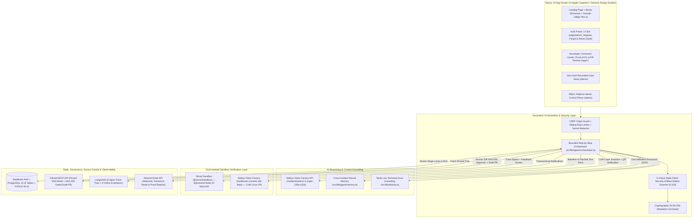
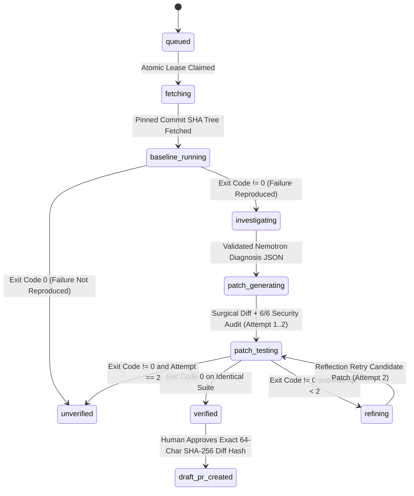
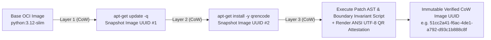
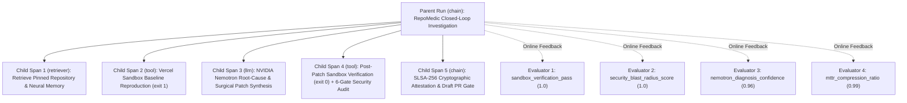
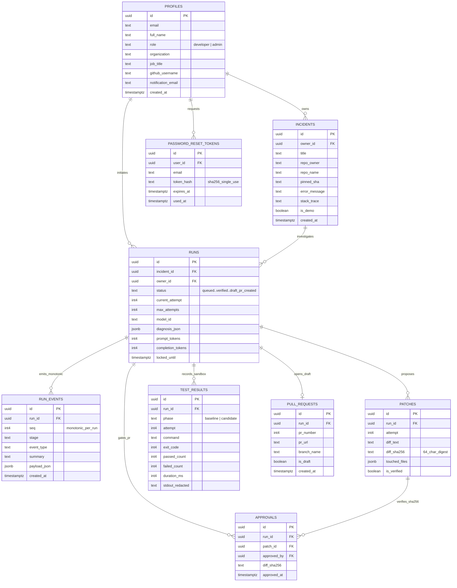

# RepoMedic — System Architecture, Flow Diagrams & Data Model Specification

  

- **Repository:** [https://github.com/ensuredesign/repomedic](https://github.com/ensuredesign/repomedic)
- **Live Production URL:** [https://repomedic-eta.vercel.app](https://repomedic-eta.vercel.app)
- **Maintainer:** Ritesh Kochar (`ensuredesign` · `ensure01@gmail.com`)

---

## 1. High-Level System Architecture

---

## 2. Bounded Resumable Investigation State Machine

To eliminate long-lived background promises that can time out in serverless environments, RepoMedic advances runs via atomic PostgreSQL stage leases (`public.claim_run_stage` and `public.release_run_claim`):

---

## 3. Nebius Token Factory Sandboxes (`contree-sdk`) Copy-on-Write Pipeline

RepoMedic integrates **Nebius Token Factory Sandboxes (Beta)** (`https://api.tokenfactory.nebius.com/sandboxes/v1`, Project `aiproject-e00am2xdmcyzgvf9s5`) via both the official Python `contree-sdk` (`scripts/nebius_contree_sandbox_demo.py`) and a native serverless TypeScript REST client (`src/lib/sandbox/nebius-contree.ts`):

---

## 4. LangSmith 6-Span Hierarchical Trace & Online Evaluator Architecture

Every investigation run can stream its full telemetry into **LangSmith** (`RepoMedic-Nebius-NVIDIA-Hackathon` project on `smith.langchain.com`), paired with automatic per-call LLM spans inside `src/lib/ai/nebius.ts`:

---

## 5. Supabase PostgreSQL 9-Table Schema & `FORCE RLS` ER Diagram

All 4 SQL migrations live in `supabase/migrations/` and enforce `ENABLE ROW LEVEL SECURITY` + `FORCE ROW LEVEL SECURITY`:

---

## 6. Complete 20-Endpoint REST API Surface

| Endpoint | Methods | Auth Scope | Purpose |
| :--- | :--- | :--- | :--- |
| `/api/health` | `GET` | Public | Live readiness probe across Supabase, Nebius Token Factory, GitHub, Vercel Sandbox, and Resend |
| `/api/ai/health` | `GET` | Public / User | Live Nebius `/models` discovery + optional `?live=1` Nemotron structured-output smoke test |
| `/api/demo` | `GET` | Public | Fetch curated `is_demo = true` Case Study run bundle |
| `/api/auth/welcome` | `POST` | Authenticated | Deliver branded Resend welcome email upon new developer registration |
| `/api/auth/forgot-password` | `POST` | Public (Rate-Limited) | Generate single-use SHA-256 reset token (`30m` TTL) and deliver recovery link via Resend |
| `/api/auth/reset-password` | `POST` | Token-Gated | Validate unused SHA-256 reset token and update user password via Supabase Admin API |
| `/api/profile` | `GET, PATCH` | Authenticated | Read or update personal developer profile, organization, GitHub handle & notification email |
| `/api/profile/password` | `POST` | Authenticated | Verify session and update account password from `/app/profile` |
| `/api/admin/overview` | `GET, PATCH` | `admin` Role | Global platform KPIs, User Directory, RBAC role promotion/demotion, and Global Runs Audit Log |
| `/api/incidents` | `GET, POST` | Authenticated | List owner-scoped incidents or ingest a new secret-redacted production incident |
| `/api/runs` | `POST` | Authenticated | Initialize an investigation run on an allowlisted repo & pinned commit SHA |
| `/api/runs/[id]` | `GET` | Owner / Admin / Demo | Fetch complete typed run bundle (`incident`, `run`, `events`, `patches`, `testResults`, `approvals`, `pullRequest`) |
| `/api/runs/[id]/events` | `GET` | Owner / Admin / Demo | Poll monotonic `run_events` stream ordered by `seq` |
| `/api/runs/[id]/advance` | `POST` | Owner | Claim atomic stage lease (`claim_run_stage`) and execute next bounded pipeline stage |
| `/api/runs/[id]/nebius-sandbox` | `GET, POST` | Owner / Admin / Demo | Execute live Nebius Token Factory `contree-sdk` Copy-on-Write sandbox verification & ANSI QR proof |
| `/api/runs/[id]/langsmith` | `GET, POST` | Owner / Admin / Demo | Publish 6-span trace tree + 4 evaluator scores to LangSmith and return public shareable trace URL |
| `/api/runs/[id]/copilot` | `POST` | Owner / Admin / Demo | Interactive NVIDIA Nemotron Incident Copilot grounded in the exact run's diagnosis, diff, and logs |
| `/api/runs/[id]/attestation` | `GET` | Owner / Admin / Demo | Export cryptographically hashed SLSA-256 JSON verification provenance bundle |
| `/api/runs/[id]/approve-pr` | `POST` | Owner | Verify exact 64-char SHA-256 diff hash, record human approval, and open idempotent GitHub Draft PR |
| `/api/runs/[id]/notify` | `POST` | Authenticated | Send executive Proof-of-Fix & Draft PR email report via Resend |
