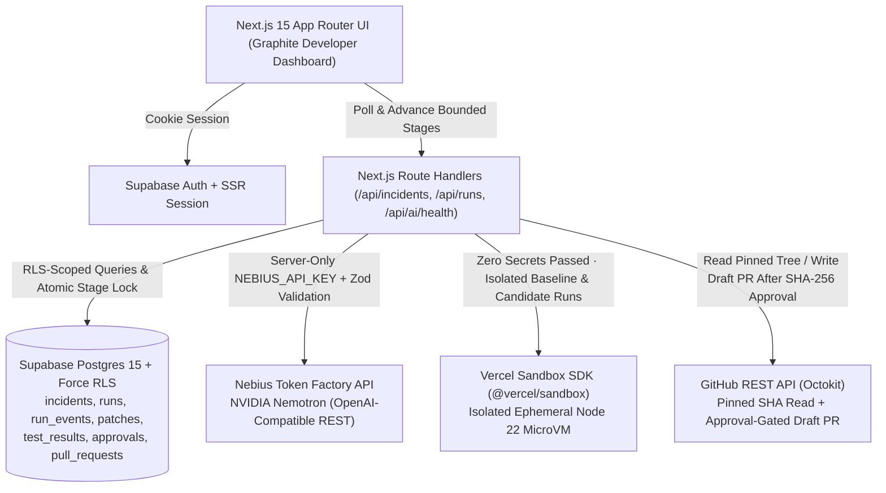
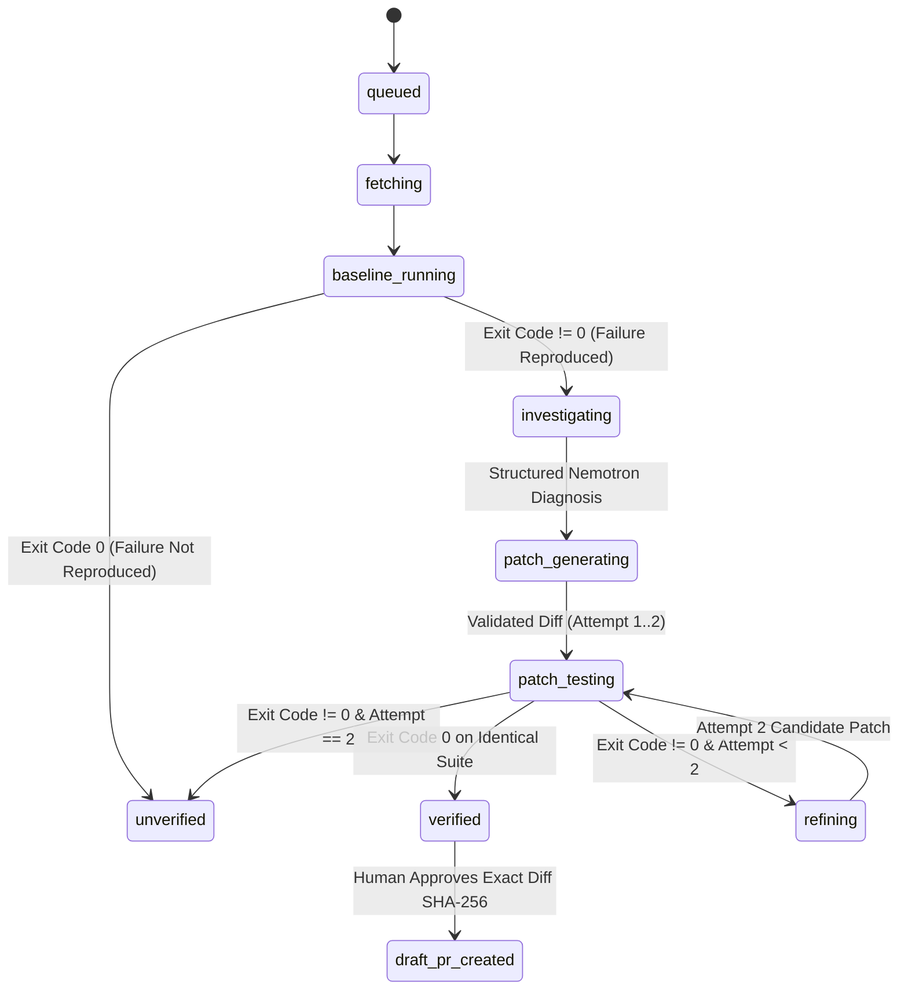

# RepoMedic Technical Architecture & Security Model

## 1. High-Level System Architecture

## 2. Bounded Resumable State Machine

To avoid unreliable background promises in serverless functions, RepoMedic uses an atomic, DB-claimed step-by-step state machine (`public.claim_run_stage`):

## 3. Defense-in-Depth Security Controls

1. **Untrusted Data Boundary:** Repository files, stack traces, test logs, and LLM responses are treated as untrusted input. Every Nebius response is parsed and validated against strict Zod schemas (`src/lib/ai/schemas.ts`).
2. **Path & Repository Allowlist (`src/lib/security/redact.ts`):**
   - Only repositories listed in `GITHUB_ALLOWED_REPOS` are accepted.
   - Path traversal (`..`), absolute paths, `.github/workflows/**`, `.env*`, lockfiles, `package.json`, and binaries are blocked from modification.
3. **Isolated Test Execution (`src/lib/sandbox/runner.ts`):**
   - Untrusted repository tests never run inside the Next.js host process.
   - `@vercel/sandbox` creates an isolated microVM, installs dependencies with `--ignore-scripts`, runs `npx vitest run`, and stops the sandbox inside a `finally` block.
4. **Human Approval Gate (`src/app/api/runs/[id]/approve-pr/route.ts`):**
   - Requires authenticated owner session, `verified` run status, and exact 64-character SHA-256 match (`approvedDiffSha256 === patch.diff_sha256`).
   - Enforces `unique (run_id)` on `public.pull_requests` and checks existing GitHub PRs on branch `repomedic/fix-<run-short-id>` for idempotency.
