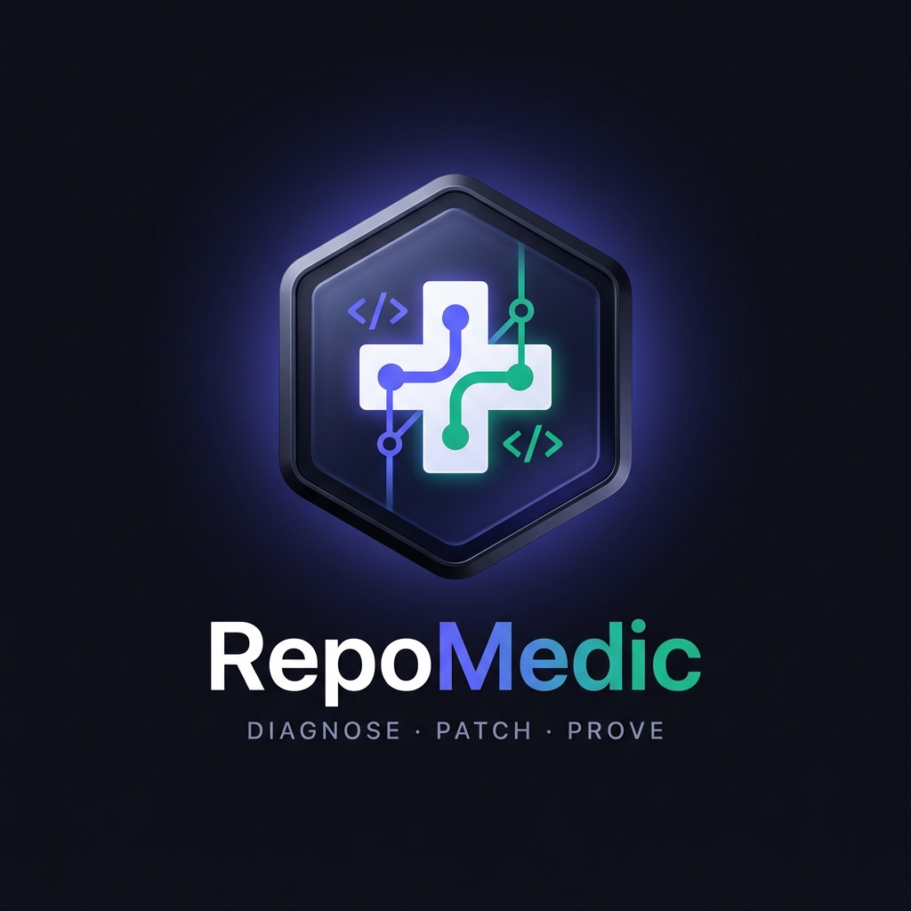
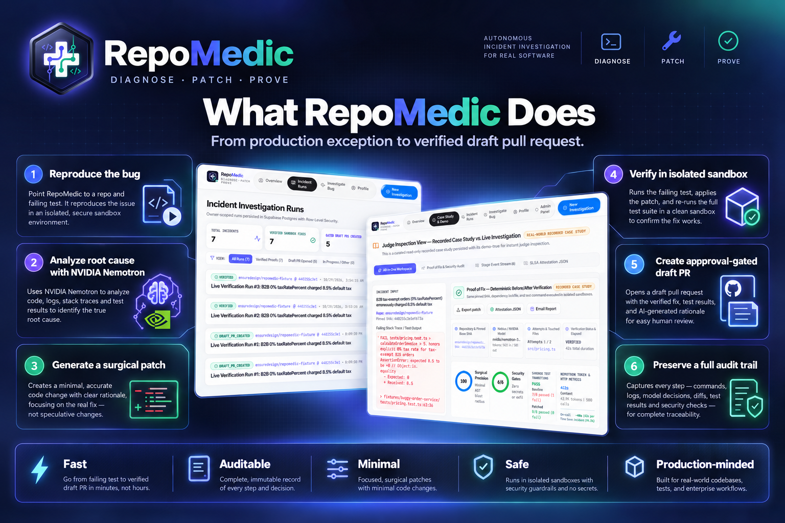
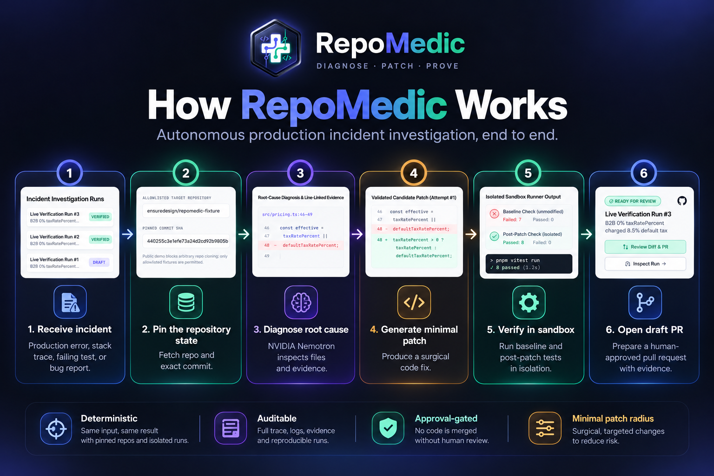
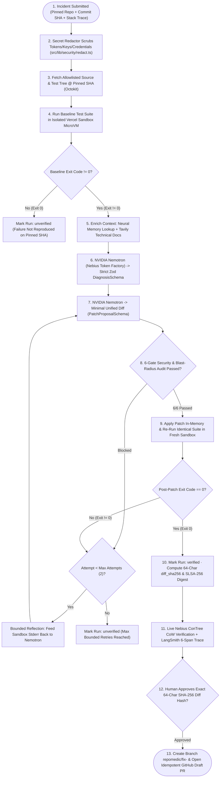
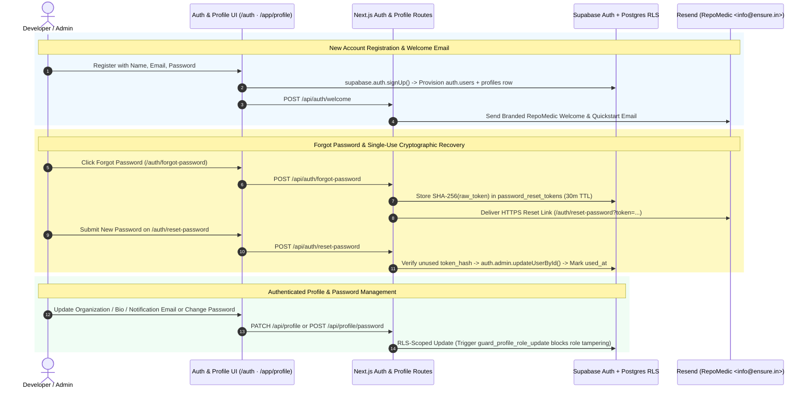
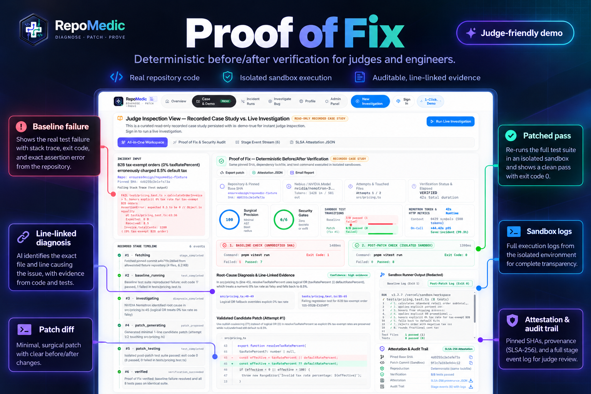
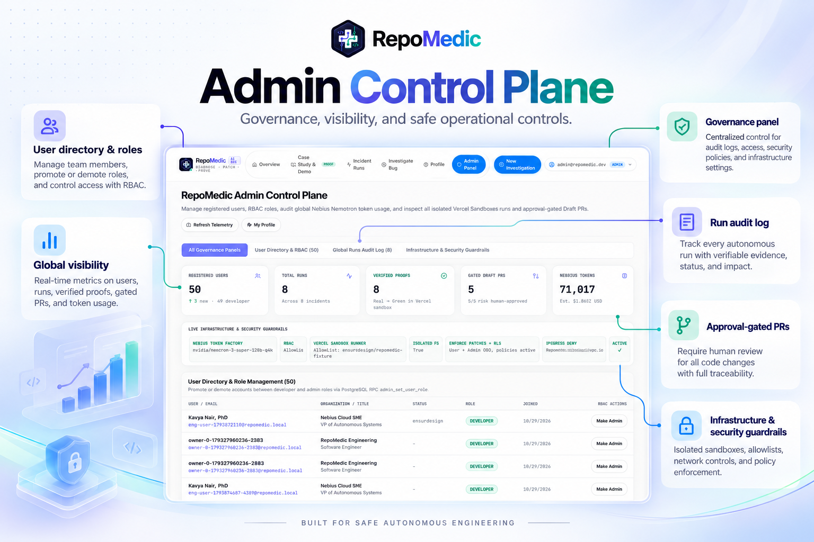

# RepoMedic — Comprehensive Technical Documentation & Engineering Manual

<div align="center">
  
  <br />
  <strong>RepoMedic — Diagnose. Patch. Prove.</strong><br />
  <em>End-to-End Engineering Specification for Autonomous Closed-Loop Incident Investigation</em>
</div>

---

## Table of Contents

1. [Executive Overview & Core Design Tenets](#1-executive-overview--core-design-tenets)
2. [End-to-End Workflow & Control-Flow Diagrams](#2-end-to-end-workflow--control-flow-diagrams)
3. [AI Reasoning Engine: Nebius Token Factory & NVIDIA Nemotron](#3-ai-reasoning-engine-nebius-token-factory--nvidia-nemotron)
4. [Dual Clean-Room Sandbox Verification Architecture](#4-dual-clean-room-sandbox-verification-architecture)
5. [Agent Observability & Online Evaluations (LangSmith)](#5-agent-observability--online-evaluations-langsmith)
6. [Authentication, Multi-Tenant Account Isolation & RBAC](#6-authentication-multi-tenant-account-isolation--rbac)
7. [Security Engineering, Threat Model & Cryptographic Provenance](#7-security-engineering-threat-model--cryptographic-provenance)
8. [Database Architecture & Zero-Downtime SQL Migrations](#8-database-architecture--zero-downtime-sql-migrations)
9. [Module-by-Module Codebase Reference](#9-module-by-module-codebase-reference)
10. [Environment Configuration, Deployment & QA Runbook](#10-environment-configuration-deployment--qa-runbook)

---

## 1. Executive Overview & Core Design Tenets

<p align="center">
  
</p>

**RepoMedic** is a production-minded agentic engineering platform built for the **Nebius × NVIDIA Global AI Hackathon**. Rather than generating unverified code suggestions in a chat window, RepoMedic enforces five strict engineering invariants:

1. **Zero Unverified Claims:** No candidate patch is ever marked `verified` unless the pinned repository's test suite **fails before the patch (`exitCode !== 0`)** and **passes after the patch (`exitCode === 0`)** on the exact same command in an isolated clean-room sandbox.
2. **Untrusted Input Boundary:** Repository files, stack traces, terminal logs, and LLM completions are treated as untrusted. Every model response passes strict **Zod** validation (`DiagnosisSchema`, `PatchProposalSchema`), path traversal checks, and a **6-gate static security scanner**.
3. **Zero Arbitrary Host Execution:** Untrusted repository tests never execute inside Next.js/Vercel API functions. All code execution occurs inside **Vercel Sandbox** microVMs (`@vercel/sandbox`) and **Nebius Token Factory Sandboxes** (`contree-sdk` Copy-on-Write containers) with zero application secrets injected.
4. **Human-Gated GitHub Writes:** RepoMedic never pushes to `main` or auto-merges. Creating a GitHub **Draft** Pull Request requires an authenticated human to explicitly approve the **64-character SHA-256 hash** of the verified unified diff.
5. **Multi-Tenant Cryptographic Auditability:** Every user's incidents, runs, patches, and profile settings are isolated by **Supabase PostgreSQL `FORCE ROW LEVEL SECURITY`**, with RBAC governance triggers (`admin_set_user_role`) and downloadable **SLSA-256 Attestation JSON** bundles.

---

## 2. End-to-End Workflow & Control-Flow Diagrams

<p align="center">
  
</p>

### 2.1 Detailed Investigation Decision & Retry Flowchart



### 2.2 Authentication, Welcome Email, Password Reset & RBAC Flow



---

## 3. AI Reasoning Engine: Nebius Token Factory & NVIDIA Nemotron

**Implementation Files:**
- `src/lib/ai/nebius.ts` — OpenAI-compatible client pointed at `https://api.tokenfactory.us-central1.nebius.com/v1/`
- `src/lib/ai/schemas.ts` — Deterministic Zod schemas (`DiagnosisSchema`, `PatchProposalSchema`, `HealthSmokeSchema`)
- `src/lib/agent/memory.ts` — Cross-incident Neural Memory retrieval from prior `verified` runs
- `src/lib/ai/tavily.ts` — Live documentation grounding via Tavily Search API

### Key Engineering Mechanisms
- **Model Selection:** Uses **`nvidia/nemotron-3-super-120b-a12b`** as primary model with automatic health discovery via `/api/ai/health`.
- **Reasoning-Content Extraction & JSON Recovery:** Handles reasoning models that emit `<think>...</think>` blocks or `reasoning_content` fields alongside structured JSON payloads, validating every field through Zod before state transitions.
- **Bounded Reflection Loop (`max_attempts = 2`):** If Attempt #1 fails post-patch sandbox tests or trips a blast-radius constraint, the exact redacted test stderr is fed back into Attempt #2 so Nemotron self-corrects without infinite loops.
- **Interactive Incident Copilot (`/api/runs/[id]/copilot`):** Allows engineers and judges to interrogate the root cause, blast radius, and edge cases using live Nemotron inference grounded in the run's persisted evidence.

---

## 4. Dual Clean-Room Sandbox Verification Architecture

<p align="center">
  
</p>

RepoMedic combines **two complementary isolated sandbox engines**:

### 4.1 Vercel Sandbox (`@vercel/sandbox` — `src/lib/sandbox/runner.ts`)
- **Purpose:** Executes full Node.js/TypeScript repository test suites (`Vitest`) on both the unmodified pinned commit (`baseline`) and the patched tree (`candidate`).
- **Hardening:**
  - Installs dependencies with `pnpm install --ignore-scripts` so malicious `postinstall` hooks in untrusted packages cannot execute.
  - Passes **zero** RepoMedic environment variables (`NEBIUS_API_KEY`, `SUPABASE_SERVICE_ROLE_KEY`, `GITHUB_TOKEN`, etc. are never mounted).
  - Enforces strict execution timeouts (`90s` ceiling) and parses structured pass/fail test counts and exit codes.

### 4.2 Nebius Token Factory Sandboxes (Beta) (`contree-sdk` — `src/lib/sandbox/nebius-contree.ts` & `scripts/nebius_contree_sandbox_demo.py`)
- **Purpose:** Demonstrates Nebius Token Factory's Copy-on-Write (`CoW`) container VM architecture (`https://api.tokenfactory.nebius.com/sandboxes/v1`, Project `aiproject-e00am2xdmcyzgvf9s5`).
- **3-Layer Copy-on-Write Pipeline:**
  1. **Layer 1 (`apt-get update -q`):** Branches `python:3.12-slim` and snapshots package index layer UUID.
  2. **Layer 2 (`apt-get install -y qrencode`):** Installs system-level native binary `qrencode` inside the sandbox image.
  3. **Layer 3 (`python3 -c <invariant_verifier>`):** Audits unified diff invariants (nullish coalescing `??` vs logical OR `||`, boundary values `0%`, `null`, `undefined`, `8.5%`) and invokes `qrencode -t ANSIUTF8` to generate a scannable terminal QR attestation pointing to the verified Proof-of-Fix.

---

## 5. Agent Observability & Online Evaluations (LangSmith)

**Implementation Files:**
- `src/lib/observability/langsmith.ts`
- `src/app/api/runs/[id]/langsmith/route.ts`

RepoMedic integrates **LangSmith (`smith.langchain.com`)** at two levels:
1. **Automatic Real-Time LLM Call Tracing:** Every call inside `src/lib/ai/nebius.ts` (`nemotron.diagnose_incident`, `nemotron.propose_patch`, `nemotron.incident_copilot`) automatically logs prompt/completion tokens, latency, and tags into project `RepoMedic-Nebius-NVIDIA-Hackathon`.
2. **Full 6-Span Closed-Loop Run Tree + 4 Online Evaluators:** Publishing a run constructs a nested 6-span execution tree (`chain` → `retriever` → `tool` → `llm` → `tool` → `chain`), attaches 4 quantitative feedback scores (`sandbox_verification_pass`, `security_blast_radius_score`, `nemotron_diagnosis_confidence`, `mttr_compression_ratio`), and generates an unauthenticated public share URL (`https://smith.langchain.com/public/<shareToken>/r`) for instant judge inspection.

---

## 6. Authentication, Multi-Tenant Account Isolation & RBAC

<p align="center">
  
</p>

- **Separate Per-User Workspaces:** Every registered account receives an isolated workspace where `incidents`, `runs`, `run_events`, `patches`, `test_results`, `approvals`, and `pull_requests` are strictly filtered by `owner_id = auth.uid()` at the PostgreSQL engine level (`FORCE ROW LEVEL SECURITY`).
- **Complete Account Lifecycle:**
  - **Sign Up + Welcome Email:** Instant account creation on `/auth` (no friction delay) paired with automatic welcome email delivery via Resend (`/api/auth/welcome`).
  - **Forgot & Reset Password:** Dedicated `/auth/forgot-password` and `/auth/reset-password` routes backed by `public.password_reset_tokens` (single-use SHA-256 hashed tokens with 30-minute expiration).
  - **Profile & Password Settings (`/app/profile`):** Authenticated users can update display name, organization, job title, GitHub handle, notification email, bio, and account password.
- **Database-Enforced RBAC:** Only users with `profiles.role = 'admin'` pass `public.is_admin()`. Trigger `public.guard_profile_role_update()` prevents any non-admin user from modifying their own `role` column even if crafting direct PostgREST calls.

---

## 7. Security Engineering, Threat Model & Cryptographic Provenance

| Threat Vector | Mitigation Implemented in RepoMedic |
| :--- | :--- |
| **Arbitrary Code Execution on Host** | Zero repo test execution in Next.js functions; strictly isolated inside Vercel Sandbox microVMs & Nebius ConTree VMs |
| **Malicious Candidate Patch (`eval`, backdoors)** | 6-check deterministic AST/regex scanner (`src/lib/security/patch-scanner.ts`) blocks dynamic code exec, shell spawning, and secret literals |
| **LLM Test Suite Tampering** | `NO_TEST_TAMPERING` rule rejects any diff touching `tests/**`, `*.test.*`, or adding `.skip`/`.only` |
| **Unauthorized GitHub Pushes / Auto-Merge** | `approve-pr` verifies exact 64-char `diff_sha256` match, enforces owner RLS, writes `repomedic/fix-*` branch only, and opens **Draft** PRs only |
| **Credential Leakage in Logs or Prompts** | `redactSecrets()` (`src/lib/security/redact.ts`) scrubs `ghp_`, `sk-`, `v1.`, `re_`, `sbp_`, JWTs, and Bearer tokens before DB writes or LLM calls |
| **Cross-Tenant Data Exposure (IDOR)** | `ENABLE` + `FORCE ROW LEVEL SECURITY` across all 9 tables; verified by live cross-user isolation tests in `tests/m1-supabase-rls.test.ts` |
| **CSRF & Endpoint Abuse** | `verifySameOrigin()` header validation + sliding-window IP/user rate limiter (`src/lib/security/api-guard.ts`) |

---

## 8. Database Architecture & Zero-Downtime SQL Migrations

Located in `supabase/migrations/`:

1. **`20261027000001_initial_schema.sql`** — Creates `profiles`, `incidents`, `runs`, `run_events`, `patches`, `test_results`, `approvals`, and `pull_requests`; enables `FORCE ROW LEVEL SECURITY`; defines `append_run_event`, `claim_run_stage`, and `release_run_claim` RPCs.
2. **`20261027000002_seed_demo_case_study.sql`** — Seeds the deterministic read-only `is_demo = true` case study for zero-auth inspection at `/demo`.
3. **`20261028000003_profiles_and_admin_panel.sql`** — Adds rich developer profile metadata, `public.is_admin()`, anti-escalation trigger `public.guard_profile_role_update()`, Admin read policies, and `public.admin_set_user_role(uuid, text)` RPC.
4. **`20261029000004_auth_welcome_and_password_reset.sql`** — Creates `public.password_reset_tokens` with `FORCE ROW LEVEL SECURITY` (service-role-only access) and B-tree indexes on `token_hash` and `(user_id, expires_at)`.

---

## 9. Module-by-Module Codebase Reference

| Directory / File | Responsibility |
| :--- | :--- |
| `src/lib/agent/orchestrator.ts` | Bounded state-machine controller coordinating GitHub tree fetch, sandbox runs, Nemotron calls, security scans, and event logging |
| `src/lib/agent/patch-applier.ts` | Pure in-memory unified diff parser & applier with strict path-traversal and hunk-context verification |
| `src/lib/agent/memory.ts` | Retrieves verified historical root-cause patterns from Supabase to accelerate recurring bug classes |
| `src/lib/ai/nebius.ts` | Nebius Token Factory inference client (`nvidia/nemotron-3-super-120b-a12b`) + automatic LangSmith LLM span hooks |
| `src/lib/ai/schemas.ts` | Zod schemas enforcing structured diagnosis, unified diff format, confidence bounds, and file allowlists |
| `src/lib/ai/tavily.ts` | Live technical documentation retrieval via Tavily Search API |
| `src/lib/sandbox/runner.ts` | Isolated Node 22 test execution via `@vercel/sandbox` (`pnpm install --ignore-scripts` + `vitest`) |
| `src/lib/sandbox/nebius-contree.ts` | Nebius Token Factory Sandboxes (`contree-sdk`) Copy-on-Write REST & CLI orchestrator with ANSI QR output |
| `src/lib/observability/langsmith.ts` | LangSmith 6-span trace tree builder, 4 online evaluators, and public shareable URL publisher |
| `src/lib/security/patch-scanner.ts` | 6-rule static security & surgical blast-radius auditor (`0–100` precision score) |
| `src/lib/security/redact.ts` | Multi-pattern secret scrubber applied to all logs, error messages, and model inputs |
| `src/lib/github/client.ts` | Octokit client restricted to allowlisted repos, pinned commit SHAs, and approval-gated Draft PRs |
| `src/lib/email/resend.ts` | Branded HTML transactional emails via Resend (`welcome`, `password-reset`, `proof-of-fix`) |
| `remotion-demo/` | Remotion 4.0 React video studio generating the zero-shake `1920×1080` smooth product film |

---

## 10. Environment Configuration, Deployment & QA Runbook

### Required Environment Variables (`.env.local` & Vercel Encrypted Secrets)

| Variable | Exposure | Purpose |
| :--- | :--- | :--- |
| `NEXT_PUBLIC_SUPABASE_URL` | Public Browser | Supabase project HTTPS endpoint |
| `NEXT_PUBLIC_SUPABASE_ANON_KEY` | Public Browser | Supabase anonymous RLS-enforced client key |
| `SUPABASE_SERVICE_ROLE_KEY` | **Server-Only** | Admin RPCs, password reset verification & system event writes |
| `NEBIUS_API_KEY` | **Server-Only** | Nebius Token Factory LLM inference + Nebius Sandboxes (`contree-sdk`) auth |
| `NEBIUS_PROJECT_ID` | **Server-Only** | Nebius Token Factory Sandboxes project scope (`aiproject-e00am2xdmcyzgvf9s5`) |
| `NEBIUS_BASE_URL` | **Server-Only** | `https://api.tokenfactory.us-central1.nebius.com/v1/` |
| `NEBIUS_MODEL` | **Server-Only** | `nvidia/nemotron-3-super-120b-a12b` |
| `LANGSMITH_API_KEY` | **Server-Only** | LangSmith observability & online evaluator publishing |
| `LANGSMITH_PROJECT` | **Server-Only** | `RepoMedic-Nebius-NVIDIA-Hackathon` |
| `TAVILY_API_KEY` | **Server-Only** | Live documentation grounding during Nemotron root-cause analysis |
| `GITHUB_TOKEN` | **Server-Only** | Least-privilege token scoped to allowlisted fixture repository |
| `RESEND_API_KEY` | **Server-Only** | Transactional welcome, password reset & Proof-of-Fix emails |

### Reproducible Verification Suite

```bash
pnpm lint               # Zero ESLint warnings/errors
pnpm typecheck          # Zero TypeScript compiler errors (tsc --noEmit)
pnpm test               # Unit tests + live Supabase RLS/RBAC + live Nebius/Sandbox smoke tests
pnpm test:closed-loop   # 3 consecutive live closed-loop runs + Draft PR idempotency verification
pnpm test:e2e           # Playwright desktop & mobile browser suite
pnpm build              # Production Next.js App Router build
```
